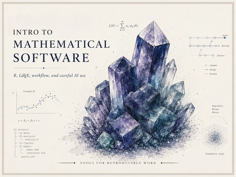
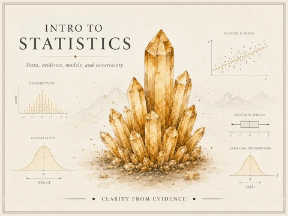

<!-- The page's single H1 and its tagline live in the Quarto title block
     above (driven by the YAML `title:` and `subtitle:`). The hero-split
     below holds the portrait and the intro prose, with no heading of its
     own. Quarto moves the first level-1 heading of a page into the title
     block however it is written (Markdown or raw HTML, seen in renders on
     2026-11-13), so the name cannot be placed inside the hero in markup.
     styles.css places the portrait beside the title block instead.

     Hero markup order is portrait, then text. On a wide screen the
     stylesheet sets the portrait in a right-hand column that starts level
     with the name. On a narrow one the same order reads name, portrait,
     paragraph with no reordering.

     Card-image policy: the three section links (Teaching / Research /
     Governed courseware) are text-only blocks under a rule. The two course cards
     carry the full course hero artwork (which already contains the course
     title) with a small caption below, via `.course-hero-card`. Hero images
     live under `assets/images/course-motifs/`. -->

::: {.hero-split}

::: {.hero-split-portrait}
{.portrait-img fig-alt="Stylized illustrated portrait of Matt Hester."}
:::

::: {.hero-split-text}
I am a statistician and teacher at the **University of Arkansas at
Little Rock**, where I teach mathematics and statistics and direct the
**Math Assistance Center**. My work spans bias-robust Bayesian evidence
synthesis, statistics education, and human-governed systems for building
durable, reproducible course materials.

This site brings together my research, teaching, and public
course-material portfolio.
:::

:::

::: {.feature-grid}

::: {.feature-card}
## [Teaching](teaching.qmd)
Current courses, my teaching approach, and the Math Assistance Center.
:::

::: {.feature-card}
## [Research](research.qmd)
Bias-robust Bayesian evidence synthesis, replication and reanalysis in
education research, and human-governed AI infrastructure.
:::

::: {.feature-card}
## [Governed courseware](research.qmd#governed-courseware)
A developing, human-governed course-authoring harness for coherent,
reproducible, and reviewable AI-assisted curriculum work.
:::

:::

## Featured course sites

These are the two featured current-course sites. The
[Course Library](courses.qmd) collects the full public course-material
portfolio; roster- and section-specific material lives in the LMS, not
here.

::: {.course-hero-card-grid}

::: {.course-hero-card}
[{.course-hero-card-img srcset="assets/images/course-motifs/thumbs/intro-math-software-hero-480.webp 480w, assets/images/course-motifs/thumbs/intro-math-software-hero.webp 800w" sizes="(min-width: 992px) 390px, (min-width: 660px) 46vw, 90vw" fig-alt="Course identity hero for Intro to Mathematical Software — a blue-violet crystal cluster surrounded by mathematical software, workflow, simulation, and version-control graphics, with the course title."}](/math-software/)

::: {.course-hero-card-caption}
[**Intro to Mathematical Software**](/math-software/) — LaTeX, R, Quarto,
reproducible workflow, and careful AI-assisted work.
:::
:::

::: {.course-hero-card}
[{.course-hero-card-img srcset="assets/images/course-motifs/thumbs/intro-stats-hero-480.webp 480w, assets/images/course-motifs/thumbs/intro-stats-hero.webp 800w" sizes="(min-width: 992px) 390px, (min-width: 660px) 46vw, 90vw" fig-alt="Course identity hero for Intro to Statistics — an amber crystal cluster surrounded by introductory statistics graphics including distributions, uncertainty, scatterplots, center and spread, and sampling distributions, with the course title."}](/intro-stats/)

::: {.course-hero-card-caption}
[**Intro to Statistics**](/intro-stats/) — data, evidence, models,
uncertainty, and simulation.
:::
:::

:::
